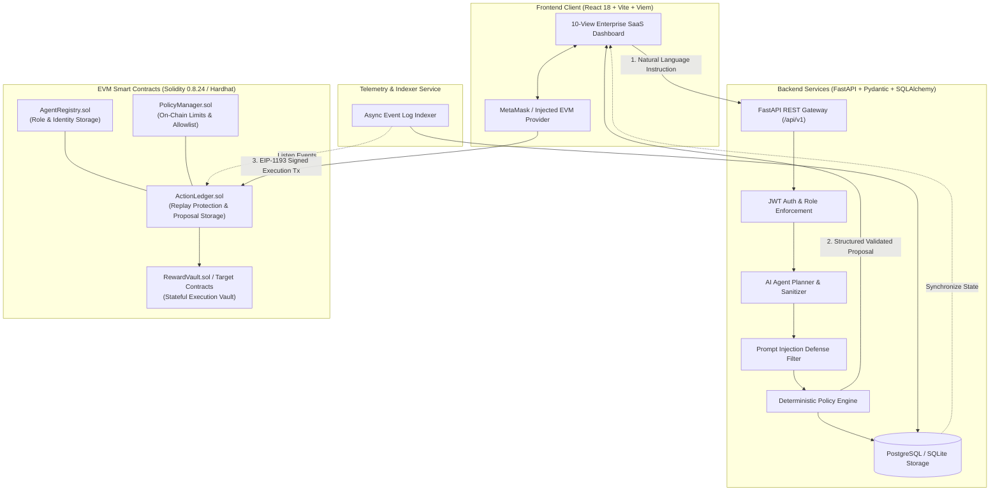

# AgentChain AI — AI-Powered Blockchain Automation & Verifiable Agent Execution Platform

[](https://github.com/Vaibhav-dev74/AgentChain/actions)
[](https://soliditylang.org/)
[](https://fastapi.tiangolo.com/)
[](https://react.dev/)
[](https://www.typescriptlang.org/)
[](https://vitejs.dev/)
[](https://tailwindcss.com/)
[](LICENSE)

> **Enterprise-grade Web3 platform connecting bounded Autonomous AI Agents to EVM Smart Contracts with deterministic policy enforcement, multi-layer prompt injection defense, and cryptographic human-in-the-loop authorization.**

---

## 📌 Executive Summary

Traditional AI agents interact with external systems through unconstrained API integrations or autonomous wallets, exposing organizations to catastrophic hallucination attacks, prompt injection exploits, and accidental asset depletion.

**AgentChain AI** bridges off-chain LLM cognition with on-chain EVM immutability through a **Zero-Trust Bounded Architecture**:
1. **Bounded Off-Chain AI**: Agents interpret natural language instructions into strictly typed action proposals, barred from direct transaction execution or wallet key possession.
2. **Deterministic Off-Chain Policy Engine**: Evaluates proposal parameters (value ceilings, recipient allowlists, role clearance, replay hashes) independently of LLM reasoning.
3. **Human-in-the-Loop Cryptographic Authorization**: High-impact proposals demand verified user signature (`MetaMask` / `Viem`).
4. **On-Chain Policy & State Enforcement**: Solidity contracts (`AgentRegistry`, `PolicyManager`, `ActionLedger`, `RewardVault`) enforce role authorizations, replay protection, and execution limits on the EVM before releasing state changes.

---

## 🏛️ System Architecture



---

## 🛡️ Security Model & Threat Defenses

| Threat Vector | Attack Mechanism | AgentChain AI Mitigation |
| :--- | :--- | :--- |
| **Prompt Injection / Jailbreak** | Manipulated text attempting to override execution parameters or drain funds | Multi-layer regex sanitizer strips overrides; bounded parser forces output into strict Pydantic schemas. Untrusted model text cannot alter target addresses. |
| **Autonomous Wallet Theft** | Compromised agent private keys executing arbitrary blockchain transactions | **No Private Keys in AI**: Agents possess zero private keys. All on-chain transactions require human-in-the-loop EIP-1193 signature from the user's wallet. |
| **Replay Attacks** | Resubmitting previously executed action IDs or payload hashes | Smart contract `ActionLedger.sol` computes a unique proposal hash and enforces `ActionStatus.Pending -> Executed` transitions with explicit duplicate revert checks. |
| **Policy Evasion** | AI hallucinating that an operation is allowed or within policy limits | **Dual Validation**: Policy rules are checked independently by Python `PolicyEngine` off-chain and verified on-chain by `PolicyManager.sol`. Smart contract reverts even if the off-chain engine were bypassed. |
| **Unauthorized Role Elevation** | Unregistered agent proposing restricted administrative actions | `AgentRegistry.sol` verifies agent active status and role (`OPERATOR`, `TREASURY_MANAGER`, `SECURITY_AUDITOR`) before admitting action proposals. |

---

## 📜 Smart Contract Architecture

The EVM layer is deployed with Solidity `0.8.24` and OpenZeppelin v5 libraries:

| Contract | Responsibilities | Key Functions |
| :--- | :--- | :--- |
| **`AgentRegistry.sol`** | Manages autonomous agent identities, assigned operational roles, and activation status. | `registerAgent()`, `setAgentStatus()`, `isAgentAuthorized()` |
| **`PolicyManager.sol`** | Stores on-chain execution policies, maximum transaction limits, and target whitelist restrictions. | `setPolicy()`, `validateAction()`, `isTargetWhitelisted()` |
| **`ActionLedger.sol`** | Single source of truth for proposed, approved, rejected, and executed blockchain actions. Prevents replay attacks. | `proposeAction()`, `approveAction()`, `executeAction()`, `rejectAction()` |
| **`RewardVault.sol`** | Example target contract illustrating authorized contract execution for test token / reward distributions. | `distributeReward()`, `deposit()`, `withdrawEmergency()` |

### Deployed Testnet / Local Addresses
- **AgentRegistry**: `0x5FbDB2315678afecb367f032d93F642f64180aa3`
- **PolicyManager**: `0xe7f1725E7734CE288F8367e1Bb143E90bb3F0512`
- **ActionLedger**: `0x9fE46736679d2D9a65F0992F2272dE9f3c7fa6e0`
- **RewardVault**: `0xCf7Ed3AccA5a467e9e704C703E8D87F634fB0Fc9`

---

## 💻 Tech Stack

### Frontend Application (`apps/web`)
- **Framework**: React 18 with TypeScript 5.5
- **Bundler & Tooling**: Vite 5.4, PostCSS, Tailwind CSS 3.4
- **Web3 Integration**: Viem 2.21, MetaMask / EIP-1193 Provider
- **UI & Animation**: Framer Motion 11, Lucide React icons
- **State Management**: React Context (`AuthContext`, `Web3Context`)

### Backend Services (`services/api` & `services/indexer`)
- **API Framework**: FastAPI 0.115, Uvicorn, Starlette
- **Data & ORM**: SQLAlchemy 2.0, PostgreSQL / SQLite, Pydantic v2
- **Auth & Security**: JWT (HS256), Passlib (Bcrypt), PyCryptodome (Keccak-256)
- **Web3 Interface**: Web3.py 7.5 async HTTP provider

### Smart Contracts (`contracts`)
- **Language**: Solidity 0.8.24 (evm target: `paris`)
- **Development Environment**: Hardhat 2.22
- **Standards & Libraries**: OpenZeppelin Contracts v5 (`AccessControl`, `Pausable`, `ReentrancyGuard`)
- **Testing**: Chai matchers, Hardhat Network, 14 comprehensive unit tests

---

## 🗂️ Monorepo Structure

```text
AgentChain/
├── .github/
│   └── workflows/
│       └── ci.yml               # Automated CI pipeline for contracts, backend & frontend
├── apps/
│   └── web/                     # Enterprise React 18 + Vite frontend
│       ├── src/
│       │   ├── components/      # Navbar, Sidebar (10 views), ProposalCard, AuthModal
│       │   ├── context/         # AuthContext (JWT) and Web3Context (MetaMask/Viem)
│       │   ├── lib/             # API client and Contract ABI bindings
│       │   └── pages/           # 10 dedicated functional SaaS views
│       ├── tailwind.config.js   # Enterprise dark theme color tokens
│       └── vite.config.ts       # Vite bundler config with path aliases
├── contracts/
│   ├── contracts/               # Solidity smart contracts
│   │   ├── ActionLedger.sol
│   │   ├── AgentRegistry.sol
│   │   ├── PolicyManager.sol
│   │   └── RewardVault.sol
│   ├── scripts/deploy.js        # Automated deployment and address manifest exporter
│   ├── test/AgentChain.test.js  # 100% pass unit tests (14 test cases)
│   └── hardhat.config.js        # Hardhat EVM network configuration
├── packages/
│   └── shared-types/            # Shared TypeScript data models across frontend & services
├── services/
│   ├── api/                     # FastAPI core backend
│   │   ├── app/
│   │   │   ├── api/v1/          # Modular endpoints (auth, agents, policies, proposals, explorer, analytics)
│   │   │   ├── core/            # Config, JWT authentication, and security helpers
│   │   │   ├── db/              # SQLAlchemy engine, session maker, and auto-seeding
│   │   │   ├── models/          # Relational entities (User, Agent, Policy, Proposal, BlockchainEvent)
│   │   │   ├── schemas/         # Pydantic validation schemas
│   │   │   └── services/        # AI Agent Planner, Policy Engine, Blockchain Service
│   │   ├── main.py              # Application entrypoint
│   │   └── run_tests.py         # Automated verification suite
│   └── indexer/                 # Real-time EVM event log indexing service
├── infra/
│   └── docker/                  # Production Dockerfiles and Docker Compose
├── .env.example                 # Standardized environment template
├── pnpm-workspace.yaml          # Monorepo workspace configuration
└── README.md                    # System documentation
```

---

## ⚡ Quickstart & Local Setup

### 1. Prerequisites
- **Node.js**: `v20.x` or `v22.x`
- **pnpm**: `v9.x` or `v10.x` (`npm install -g pnpm`)
- **Python**: `3.11+` or `3.13`
- **Git**

### 2. Clone & Environment Configuration
```bash
git clone https://github.com/Vaibhav-dev74/AgentChain.git
cd AgentChain

# Copy environment variables
cp .env.example .env
```

### 3. Install Monorepo Dependencies
```bash
pnpm install
```

### 4. Smart Contracts: Compile, Test & Deploy
```bash
# Run 14 comprehensive unit tests
pnpm --filter @agentchain/contracts test

# Start local Hardhat EVM node (Terminal 1)
npx hardhat node --dir contracts

# Deploy contracts to local network (Terminal 2)
pnpm --filter @agentchain/contracts run deploy
# or from root:
# pnpm run deploy:contracts
```

### 5. Backend API: Setup & Run
```bash
cd services/api

# Create and activate virtual environment
python -m venv venv
# Windows:
.\venv\Scripts\activate
# Linux/macOS:
source venv/bin/activate

# Install dependencies
pip install -r requirements.txt

# Run backend verification suite
python run_tests.py

# Launch FastAPI development server (port 8000)
python main.py
```
*Interactive Swagger Documentation will be live at `http://localhost:8000/docs`.*

### 6. Frontend Dashboard: Launch Web App
```bash
# Return to root and run web client
pnpm --filter @agentchain/web dev
```
*Frontend will be running at `http://localhost:5173`.*

---

## 🚀 Step-by-Step End-to-End Workflow

```text
[ Natural Language User Input ]
             ↓
[ AI Agent Planner ] -------------> Strips prompt injections, generates structured JSON proposal
             ↓
[ Deterministic Policy Engine ] ---> Checks value caps, whitelisted contracts, agent roles
             ↓
[ Proposal State: PENDING ] -------> Displayed in Approval Center with Risk Assessment Meter
             ↓
[ Human Reviewer Approval ] -------> User reviews parameters and signs via MetaMask (Viem)
             ↓
[ ActionLedger.executeAction() ] --> EVM contract validates policy hash & executes on target vault
             ↓
[ State: EXECUTED ] ---------------> Event indexed, transaction recorded with verified block explorer link
```

1. **User Request**: Navigate to **AI Agent Workspace** and enter:
   > *"Issue a reward payout of 10 test tokens to recipient 0x70997970C51812dc3A010C7d01b50e0d17dc79C8"*
2. **AI Proposal Generation**: The AI Planner extracts parameters, performs prompt injection defense, assigns required operational role (`OPERATOR`), and prepares a proposal.
3. **Policy Verification**: The Policy Engine checks against active rule set (default: max 50 tokens, whitelisted target `RewardVault`).
4. **Approval Center**: Proposal appears with Risk Meter (`LOW RISK`), raw payload inspector, and cryptographic action hash.
5. **Wallet Authorization**: Reviewer clicks **"Approve & Execute via Wallet"**. MetaMask prompts for transaction signature on `ActionLedger.executeAction()`.
6. **Immutable Ledger Record**: Transaction confirms on-chain; event indexer marks proposal as `EXECUTED` and records block number and transaction hash.

---

## 📡 API Reference Summary

| Endpoint | Method | Description | Auth Required |
| :--- | :---: | :--- | :---: |
| `/api/v1/auth/register` | `POST` | Register a new user account with wallet address | No |
| `/api/v1/auth/login` | `POST` | Authenticate and obtain JWT bearer token | No |
| `/api/v1/auth/me` | `GET` | Get current authenticated user profile & role | Yes (`Bearer`) |
| `/api/v1/agents` | `GET` | List all registered AI agents with status and role | Yes |
| `/api/v1/agents/plan` | `POST` | Process natural language instruction into structured proposal | Yes |
| `/api/v1/policies` | `GET` | List active policy rules, max limits, and whitelists | Yes |
| `/api/v1/policies` | `POST` | Create or update execution policy (Admin only) | Yes (`ADMIN`) |
| `/api/v1/proposals` | `GET` | Retrieve action proposals with status filtering | Yes |
| `/api/v1/proposals/{id}/review` | `POST` | Record user approval or rejection of an action proposal | Yes |
| `/api/v1/proposals/{id}/execute` | `POST` | Record verified on-chain execution transaction hash | Yes |
| `/api/v1/explorer/contracts` | `GET` | List deployed verified contracts and network info | No |
| `/api/v1/explorer/transactions` | `GET` | Retrieve real-time on-chain transaction records | No |
| `/api/v1/analytics/overview` | `GET` | Aggregated analytics (proposals, approval rates, gas stats) | No |

---

## 🧪 Testing Suite

### 1. Smart Contract Hardhat Tests
```bash
pnpm --filter @agentchain/contracts test
```
- `AgentRegistry`: Identity registration, role assignment, status toggling, duplicate prevention.
- `PolicyManager`: Limit validation, target allowlisting, version increments, threshold breaches.
- `ActionLedger`: Proposal submission, state transitions, replay prevention, reentrancy guards.

### 2. Backend Automated Test Runner
```bash
python services/api/run_tests.py
```
- Validates prompt injection defense against malicious payloads.
- Validates deterministic policy engine against token ceilings.
- Validates user auth, proposal creation, review workflow, and execution syncing.

### 3. Frontend Production Build Check
```bash
pnpm --filter @agentchain/web build
```
- Validates TypeScript types across all 10 views and compiles optimized production assets via Vite.

---

## 🐳 Docker Deployment

To launch the full AgentChain AI stack using Docker Compose:

```bash
docker compose -f infra/docker/docker-compose.yml up --build -d
```
Services spun up:
- `agentchain-web`: Nginx-served optimized React 18 production build (`http://localhost:80`)
- `agentchain-api`: Uvicorn FastAPI backend container (`http://localhost:8000`)
- `agentchain-postgres`: Managed PostgreSQL database (`port 5432`)

---

## 📄 License
This project is licensed under the [MIT License](LICENSE).
